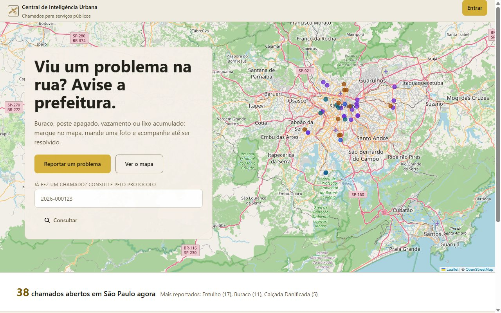
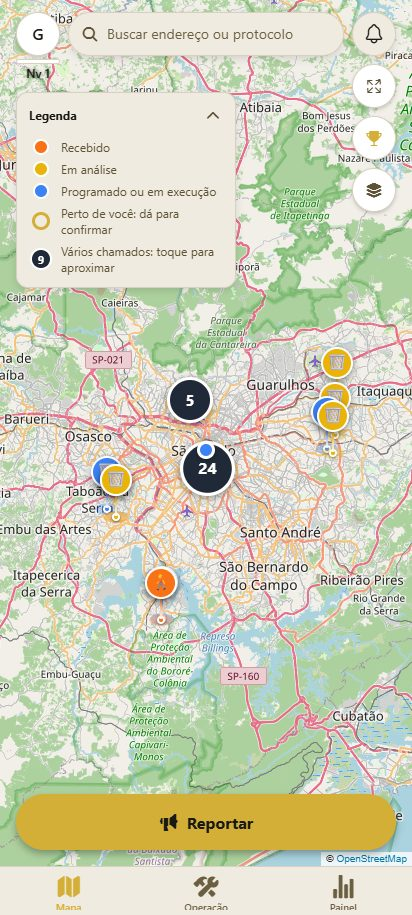
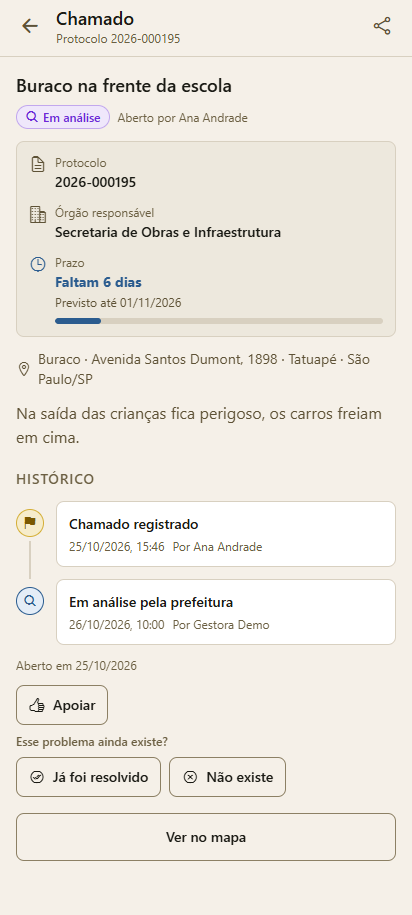
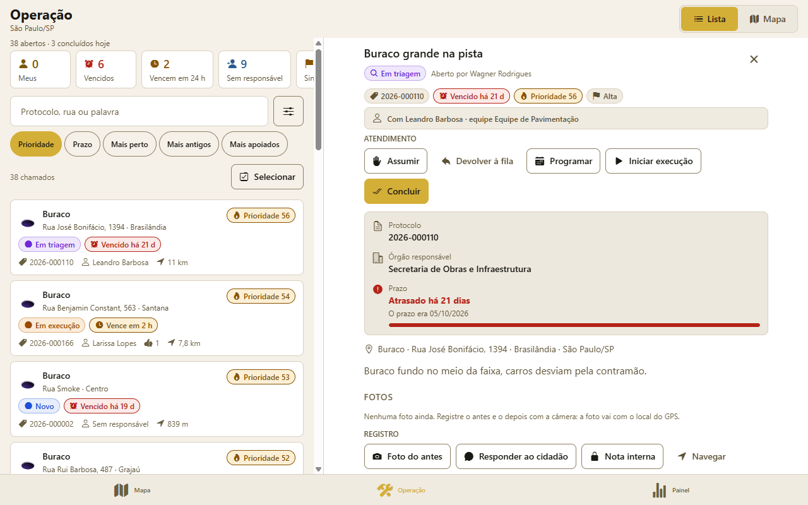
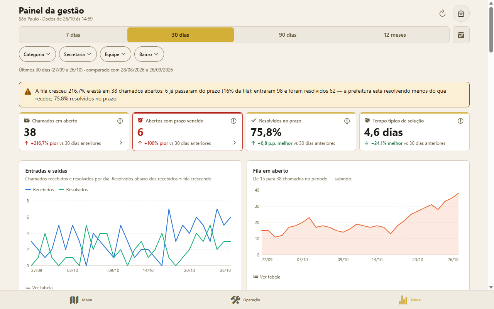
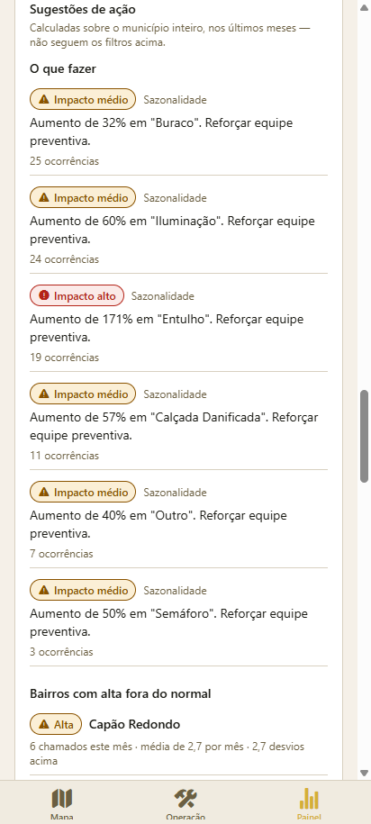
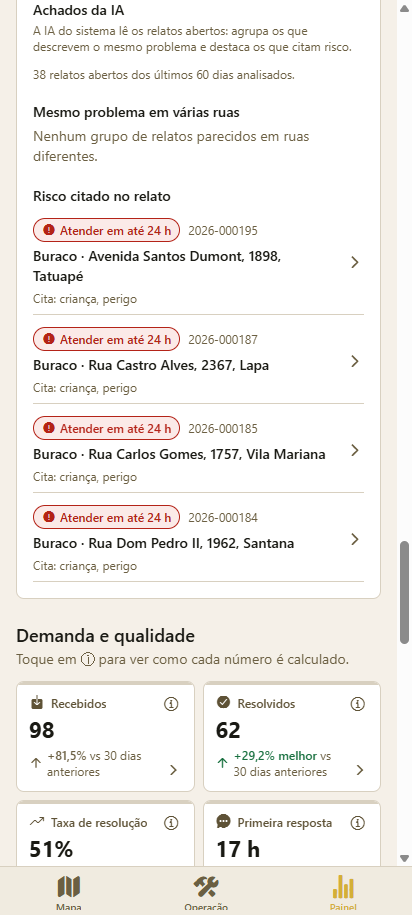
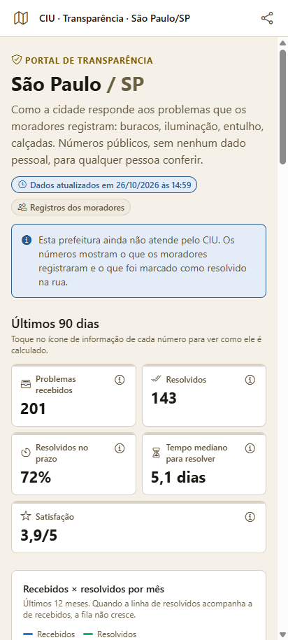
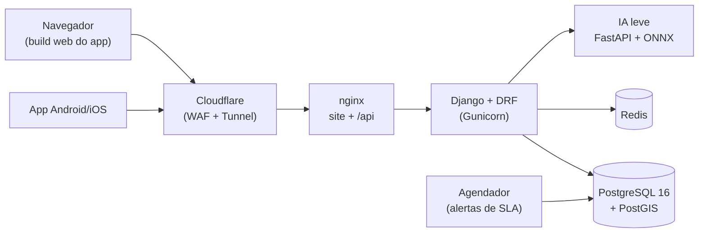

<div align="center">


# Central de Inteligência Urbana

*Zeladoria urbana para prefeituras: o cidadão reporta, a equipe executa, a gestão acompanha e a cidade publica os números.*

</div>

<p align="center">
  
  
  
  
</p>

<p align="center"><a href="docs/README.en.md">🇺🇸 English version</a></p>

| | |
| --- | --- |
| **Versão** | 1.1.0 (plataforma v3) |
| **Estado** | Em produção em [tcc.josemurilors.com.br](https://tcc.josemurilors.com.br), com entregas incrementais |
| **Contexto** | Trabalho de Conclusão de Curso — Engenharia da Computação, Universidade Virtual do Estado de São Paulo (UNIVESP) · Orientador: Marcos Norio Watanabe |
| **Alvo** | Prefeituras (B2G) e cidadãos — Android, iOS e navegador |

> **Limite principal:** a IA do sistema é leve e local. Ela detecta duplicados,
> agrupa relatos parecidos e destaca risco citado no texto; **não** classifica
> a categoria do chamado (quem escolhe é o cidadão) e foi medida só com dados
> sintéticos.

## Sumário

[Início rápido](#início-rápido) · [1. Objetivo e telas](#1-objetivo-e-telas) ·
[2. Arquitetura](#2-arquitetura) · [3. Estrutura](#3-estrutura-do-repositório) ·
[4. Domínio e papéis](#4-domínio-e-papéis) · [5. API](#5-api) ·
[6. IA e geoespacial](#6-ia-e-geoespacial) · [7. Segurança](#7-segurança-e-privacidade) ·
[8. Execução local](#8-desenvolvimento-e-execução-local) ·
[9. Critérios de aceite](#9-critérios-de-aceite) · [10. Escopo](#10-limites-de-escopo-e-evolução) ·
[11. Contribuição](#11-contribuição) · [12. Documentação](#12-documentação-complementar) ·
[13. Autores e licença](#13-autores-e-licença)

## Início rápido

```bash
cp .env.example backend-python/.env
docker compose -f docker-compose.dev.yml up -d backend redis
docker compose -f docker-compose.dev.yml exec backend python manage.py migrate
cd mobile && npm install && npm run web
```

Abra `http://localhost:8081` — o mesmo app roda no navegador, no Android e no iOS.

## 1. Objetivo e telas

O cidadão marca no mapa um problema de infraestrutura (buraco, poste apagado,
entulho, calçada, árvore caída, semáforo), anexa foto e GPS e recebe um
**protocolo**. A prefeitura atende numa fila priorizada, a gestão acompanha
prazos (SLA) e resultados, e qualquer pessoa vê os números da cidade. O sistema
**não** despacha equipes nem integra com sistemas legados da prefeitura.

**Uma interface só:** o app em [`mobile/`](mobile/) (Expo) é o único cliente. O
build web dele é o site, então quem usa no computador ou no navegador do
celular vê a mesma tela de quem instalou o app.

| Página de início (web) | Mapa | Chamado |
| --- | --- | --- |
|  |  |  |

| Operação (fila e ficha de atendimento) | Painel da gestão |
| --- | --- |
|  |  |

| Sugestões de ação | Achados da IA | Transparência (público) |
| --- | --- | --- |
|  |  |  |

*Telas do município de demonstração (`seed_demo`, dados fictícios).*

### Entregas da versão

- **Cidadão:** reporte com foto e GPS, protocolo `AAAA-NNNNNN`, linha do tempo
  (Recebido → Em análise → Programado → Em execução → Resolvido / Não procede),
  consulta pelo protocolo sem login, apoio, sinalização ("já foi resolvido",
  "não existe"), avaliação (1–5), reabertura em até 30 dias, exportação dos
  próprios dados (LGPD), nível e ranking por cidade.
- **Operação:** fila priorizada por prazo, prioridade e apoios; assumir,
  programar, executar, concluir com foto, resposta pública, nota interna,
  ações em lote, ordem de serviço em PDF; funciona sem rede (fila offline com
  `Idempotency-Key`).
- **Gestão:** BI do município (SLA, lead time P50/P90, CSAT, aging, hotspots,
  produtividade) com drill-down e exportação; sugestões de ação por regra e
  achados da IA; secretarias, equipes, categorias, SLA, moderação e auditoria.
- **Público:** portal de transparência, dados abertos (CSV/GeoJSON) e Open311.
- **Plataforma:** Android, iOS e web (instalável como PWA), tema claro/escuro,
  contraste WCAG AA verificado por script, layout do celular ao computador.

## 2. Arquitetura



**Escrita:** o app envia o chamado → o backend resolve o município pelo ponto
(PostGIS), aplica regras de duplicado, roteia para a secretaria e calcula o
prazo. **Leitura:** fila, painel e transparência consultam o PostgreSQL; as
sugestões da IA ficam 6 h em cache no Redis.

| Área | Escolha | Papel |
| --- | --- | --- |
| App e site | Expo SDK 57, React Native 0.86, Expo Router, Leaflet (web) | Interface única |
| Backend | Django 5.2, DRF, Gunicorn, simplejwt | API, regras, permissões |
| Dados | PostgreSQL 16 + PostGIS 3.4, Redis | Chamados, geometria, cache |
| IA | FastAPI + ONNX Runtime, MiniLM-L12-v2 multilíngue | Embeddings e termos de risco |
| Borda | Cloudflare (WAF/TLS) + Tunnel → nginx | Entrada única, cabeçalhos de segurança |
| CI/CD | GitHub Actions + VPS ARM64 (Hetzner) | Testes e deploy a cada push |

## 3. Estrutura do repositório

```text
tcc-manutencao-urbana/
├── mobile/            # app Expo (Android, iOS e web) — único cliente
├── backend-python/    # API Django + DRF
├── ia/                # serviço de IA leve (FastAPI + ONNX) e experimentos
├── docs/              # contrato da API, diagramas, produção, Play Store, imagens
├── scripts/           # testes do backend, seed demo, backup
├── nginx.Dockerfile   # build web do app + nginx
├── nginx.prod.conf
├── docker-compose.yml       # produção
└── docker-compose.dev.yml   # desenvolvimento
```

Cada subprojeto tem README próprio: [app](mobile/README.md),
[backend](backend-python/README.md), [IA](ia/README.md).

## 4. Domínio e papéis

Cada servidor atua em **um** município (`users.municipio_id`); regras em
`backend-python/core/permissoes.py`.

| Papel | Pode |
| --- | --- |
| `cidadao` | Reportar, apoiar, sinalizar, avaliar, reabrir o próprio chamado (30 dias) |
| `operador` | Fila, assumir, mudar status, notas, resposta pública, evidências |
| `gestor` | + rejeitar, duplicado, reabrir, atribuir, SLA, BI, exportações, moderação |
| `admin_municipal` | + equipe e papéis, secretarias, categorias, configuração, auditoria |
| `super_admin` | Gere qualquer município (`?municipio=`); opera só no seu |

Regras de negócio principais: status só muda por `defeitos/fluxo.py`
(transições, histórico e aviso ao cidadão); duplicado = mesma categoria aberta
a poucos metros; quarentena anti-spam por strikes (sinalizações "não existe"
confirmadas). Vocabulário completo:
[`docs/arquitetura/contrato-v3.md`](docs/arquitetura/contrato-v3.md).

## 5. API

Prefixo `/api/v1/`; fonte única de rotas e esquemas no contrato v3.

| Prefixo | Conteúdo |
| --- | --- |
| `auth/` | Entrada por código de e-mail, Google, perfil |
| `defeitos/` | Chamados: criar, listar, apoiar, sinalizar, protocolo |
| `operacao/` `gestao/` `notificacoes/` | Fila de campo, administração, avisos |
| `bi/` | Painel, exportação, `sugestoes-ia/` (achados da IA leve) |
| `transparencia/` `dados-abertos/` `open311/` | Público, sem login e sem dados pessoais |
| `municipios/` `categorias/` `health/` | Lookups e verificação de saúde |

## 6. IA e geoespacial

- **IA leve** ([`ia/`](ia/README.md)): MiniLM multilíngue em ONNX, local, sem
  enviar dados para fora. Usada em três pontos: **duplicados** pelo texto
  (cosseno ≥ 0,75 num raio maior), **temas** (relatos abertos parecidos, até
  1,5 km, em 2+ ruas) e **risco citado** ("fio partido", "criança"…) no Painel.
  Sem o serviço, o backend segue (disjuntor: 3 falhas → pausa de 60 s).
- **Medido** (dados sintéticos): categoria pelo texto 68,6% de acerto — por
  isso não é usada para classificar sozinha; duplicados F1 0,46–0,53 em 16
  pares. Relatório: [`ia/experimentos/RELATORIO_ACADEMICO.md`](ia/experimentos/RELATORIO_ACADEMICO.md).
- **Sugestões por regra:** recapeamento (3+ no mesmo ponto), sazonalidade
  (+30% na categoria), bairro crítico (< 50% resolvidos) e anomalia por z-score.
- **PostGIS:** 5.570 municípios (IBGE); município do chamado por `ST_Within`
  com tolerância na borda.

## 7. Segurança e privacidade

- Entrada por código de e-mail ou Google; JWT com rotação; senhas com bcrypt.
- CPF cifrado em repouso (AES-256-GCM) + HMAC para busca; segredos só em
  variáveis de ambiente.
- Fotos: JPEG/PNG/WebP/AVIF até 5 MB, convertidas para WebP ≤ 1200 px, com
  blur gaussiano de privacidade.
- nginx: HSTS, `nosniff`, `X-Frame-Options`, `Permissions-Policy` (GPS e câmera
  só no próprio domínio); rate limiting no Redis; contêiner Django sem root.

Os testes cobrem regras e permissões; não há teste de carga nem auditoria
externa de segurança.

## 8. Desenvolvimento e execução local

**Pré-requisitos:** Docker + Compose v2, Node.js ≥ 22. Python 3.12–3.14 e GDAL
(`libgdal-dev`) só para rodar o Django fora do Docker.

1. `cp .env.example backend-python/.env` e preencha `ENCRYPTION_KEY`, `DB_PASSWORD`…
2. `docker compose -f docker-compose.dev.yml up -d backend redis` (API em `localhost:8000`)
3. `docker compose -f docker-compose.dev.yml exec backend python manage.py migrate`
4. Opcional — IA: `docker compose -f docker-compose.dev.yml --profile ia up -d ia`
5. Opcional — dados demo: `scripts/seed-demo.sh` (São Paulo, 600 chamados, e-mails `@demo.ciu`)
6. `cd mobile && npm install && npm run web` (ou `npm start` para o Expo Go)

### Testes

```bash
scripts/test-backend.sh                              # pytest do backend, banco próprio
cd mobile && npm run lint && npm run typecheck && npm run check:contrast
```

Produção (deploy, túnel, agendador, backup): [`docs/producao.md`](docs/producao.md).

## 9. Critérios de aceite

- [x] Cidadão abre chamado com foto e GPS e recebe protocolo
- [x] Acompanhamento pelo protocolo sem login
- [x] Fila de operação priorizada, com ações em lote e modo offline
- [x] Painel de BI com SLA, lead time, CSAT, hotspots e exportação
- [x] Transparência, dados abertos e Open311 sem dados pessoais
- [x] Mesma interface no Android, iOS e navegador
- [x] IA leve em produção: duplicados, temas parecidos e risco citado
- [ ] Classificação automática da categoria — modelo existe, mas 68,6% em dados sintéticos não basta
- [ ] Acurácia da IA medida em relatos reais — só há dataset sintético
- [ ] Push no navegador — o site tem apenas a central de avisos in-app

## 10. Limites de escopo e evolução

**Dentro:** relato, atendimento, gestão e transparência de um município por
equipe. **Fora:** integração com sistemas legados da prefeitura (ERP, central
156). **Evoluções possíveis:** plano de ação gerado
por modelo de linguagem a partir das sugestões, push no navegador, avaliação da
IA com relatos reais.

## 11. Contribuição

- Branches a partir da `master`; PR com revisão de outra pessoa do grupo.
- Commits em Conventional Commits (`feat:`, `fix:`, `docs:`), validados por
  commitlint/husky.
- Antes do PR: `scripts/test-backend.sh`, lint e typecheck do app.

## 12. Documentação complementar

- [Contrato v3](docs/arquitetura/contrato-v3.md) · [Diagramas](docs/arquitetura/diagramas.md) · [Produção](docs/producao.md)
- [App](mobile/README.md) · [Backend](backend-python/README.md) · [IA](ia/README.md) · [Relatório da IA](ia/experimentos/RELATORIO_ACADEMICO.md)
- [Play Store](docs/play-store/ficha.md) · [Deep links](docs/deep-links/README.md)

## 13. Autores e licença

TCC *Central de Inteligência Urbana: PWA para reporte, classificação automática
e priorização de problemas de infraestrutura* — Engenharia da Computação,
UNIVESP.

| Nome | RA | GitHub |
| --- | --- | --- |
| Caio Alencar Cinel | 2223869 | [@caiocinel](https://github.com/caiocinel) |
| Gabriel Monteiro Alves | 2015614 | — |
| Gabriel Venancio da Silva | 2231736 | — |
| Ivaildes Bertoldo | 2013692 | — |
| José Murilo Rodrigues Sabalo | 2232083 | [@josemurilors](https://github.com/josemurilors) |
| Joseph Jucelio de Oliveira Santos | 2224541 | — |
| Tiago José Schiabelli | 2226164 | — |

Código: José Murilo (backend, infraestrutura, BI, IA) e Caio (app Expo, login
com Google, sinalização e quarentena, operação, rotas).

Orientador: Marcos Norio Watanabe.

Licença MIT — texto em [`LICENSE`](LICENSE).
