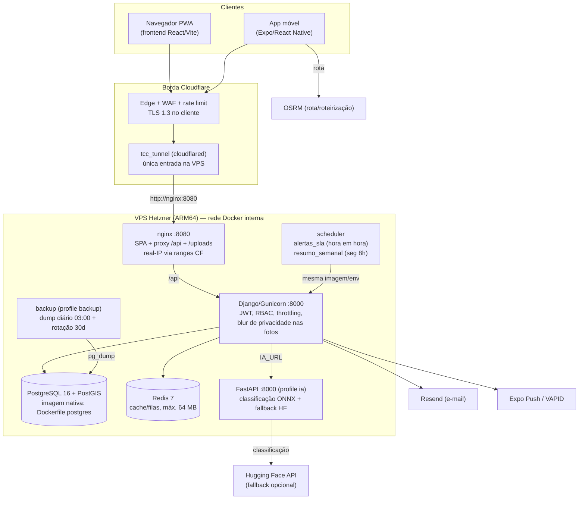
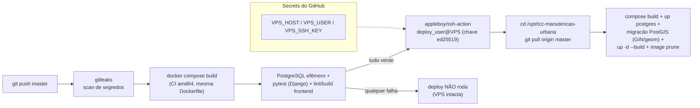
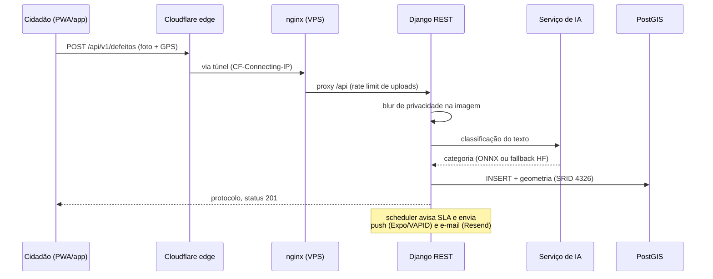

# Diagramas da arquitetura

Gerado a partir de `docker-compose.yml`, `nginx.prod.conf`, `Dockerfile.postgres` e
`.github/workflows/deploy.yml`. Atualize junto com o código (regra de manutenção do
`contrato-v3.md`).

## 1. Arquitetura de runtime (produção)

Nenhuma porta da VPS é alcançável pela internet além de SSH (22): o bind 80/443
existe por herança de era pré-túnel e está bloqueado pelo firewall da nuvem; o
tráfego entra exclusivamente via Cloudflare Tunnel. O backend **não publica porta
no host** desde `e91b2b4` — só nginx alcança `backend:8000` pela rede interna.

## 2. Pipeline de deploy (GitHub Actions → VPS)

## 3. Sequência de uma solicitação de cidadão

